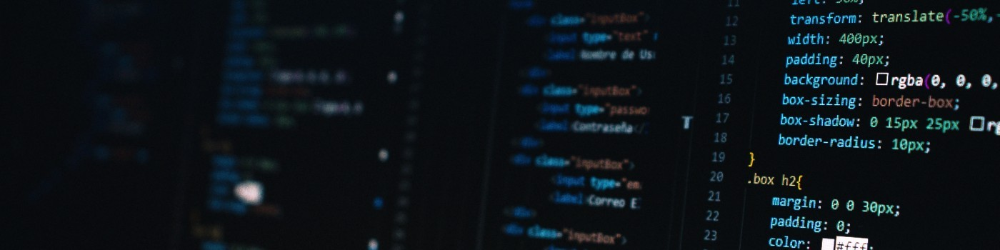

# Abibubble

## About me

Hi there,

I'm Abi, a software engineer and accessibility specialist at [giffgaff](https://www.giffgaff.com/), a UK-based mobile company. I live near London, and I work in the Devices Team on the core phones journey, where people choose and buy phones. It's built as micro frontends.

I've also looked after giffgaff's design systems. I maintained the legacy SCSS design system, then built its replacement in React and TypeScript. I maintained the new one too, and supported teams as they moved their pages over to it.

## Accessibility

Accessibility matters to me because I never want my code to be the thing that shuts someone out. Whether you're using something I've built, reading something I've written, or listening to one of my talks, you deserve the same great experience as everyone else. For me, it all comes down to equity and fairness.

I'm a trained accessibility auditor, and I help teams across giffgaff build and test products that meet the Web Content Accessibility Guidelines (WCAG).

I also founded and lead HAND (Home of Accessibility and NeuroDiversity), giffgaff's nationally recognised network for accessibility and neurodiversity. In 2026, I was Highly Commended for Network Inspirational Role Model at the Employee Network Awards.

In June 2026, I spoke at LeadDev's LDX3 London, with a talk called [Moving accessibility from debt to done](https://leaddev.com/technical-direction/moving-accessibility-from-debt-to-done-at-giffgaff).

You can find all my talks, articles, and projects on [my website](https://abiharrisonnye.dev).

## Things I've built

- [Inclusion Toolkit](https://inclusiontoolkit.org): free resources about accessibility and neurodiversity
- [My personal website](https://abiharrisonnye.dev): built with React and TypeScript, prerendered to static HTML, and aiming for WCAG 2.2 AAA
- [Coaster Ranker](https://abibubble.github.io/coaster-ranker/): an accessible React and TypeScript app for ranking roller coasters
- [bad-a11y](https://abibubble.github.io/bad-a11y/): a deliberately inaccessible page, to practise finding and fixing accessibility issues

## Away from work

When I'm not coding, you'll probably find me travelling, riding roller coasters, watching motorsport, or trying to escape from an escape room. At home, I have two rescue cats, Crouton and Katsu.

Before tech, I taught people to drive and worked in pubs. I made my career switch with [Code Institute](https://codeinstitute.net/), where I earned a Diploma in Fullstack Software Development with a merit in 2021.

## Contact me

